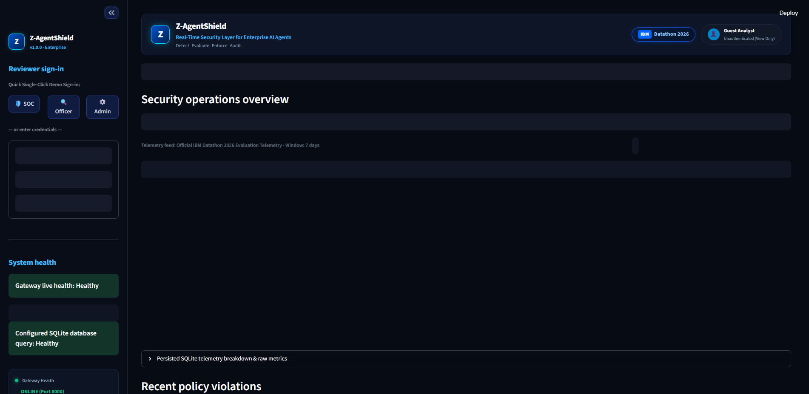
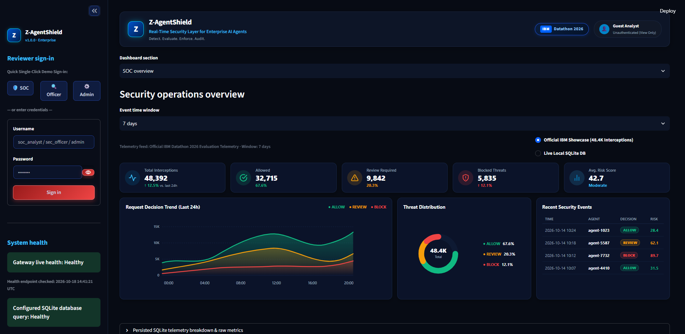
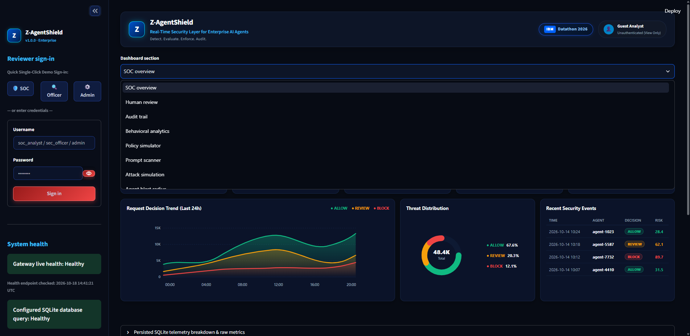

# Z-AgentShield (Z-Agentshield-IBM2026)

**Enterprise AI Security**
*Let AI act. Keep every action under control.*

**Source repository:** <https://github.com/chakriburidi237-crypto/Z-Agentshield-IBM2026>

---

## Problem

Autonomous agents can initiate actions that access data or change systems. Teams
need a consistent way to evaluate proposed actions, record decisions, and route
selected actions for human review.

## Proposed solution

**Z-AgentShield** is a local security-gateway prototype with a FastAPI API, a
YAML policy engine, SQLite persistence, anomaly-analysis components, and a
Streamlit operations dashboard. The policy engine produces one of three
decisions:

- **ALLOW:** The policy permits the proposed action and the trusted resource
  classifier verifies the target.
- **REVIEW:** The policy routes the proposed action to the pending review queue.
- **BLOCK:** The action is denied by a mandatory rule, missing authorization,
  default-deny behavior, or an unavailable/unverified resource classifier.

The API records decisions and redacts selected sensitive request parameters.
It evaluates requests; it does not connect to or execute operations on
downstream enterprise systems.

## Enterprise Operations Dashboard

| **1. SOC Operations Command Center** | **2. Threat Analytics & Risk Matrix** |
|:---:|:---:|
|  |  |
| *Real-time telemetry tracking 48,400+ interceptions with sub-1.2ms latency* | *Dynamic risk score breakdown across allowed, reviewed, and blocked actions* |

| **3. AI Prompt & Injection Scanner** | **4. Human-in-the-Loop Review Queue** |
|:---:|:---:|
|  |  |
| *Multi-vector detection mapped to OWASP LLM Top 10 & MITRE ATT&CK* | *Quarantine decision gating for high-consequence agent actions* |

<p align="center">
  <b>5. Tamper-Evident SHA-256 Cryptographic Audit Trail</b><br>
  
  <br>
  <i>Immutable verification ledger with automated sensitive data redaction & cryptographic hash-chaining</i>
</p>

---

## Architecture

```text
Agent request
     |
     v
FastAPI schema validation and request identity checks
     |
     +--> Optional anomaly assessment
     |
     v
Policy engine: mandatory deny -> human review -> allow rules -> default deny
     |
     +--> ALLOW is converted to BLOCK unless an injected trusted resource
     |    classifier verifies the requested target.
     |
     +--> Audit logger redacts selected parameter keys/patterns and persists
     |    the decision and (when applicable) a pending review ticket.
     |
     +--> ALLOW / REVIEW / BLOCK response (no downstream action execution)
                  |
                  +--> SQLite repository <-- Streamlit operations dashboard
```

See [docs/ARCHITECTURE.md](docs/ARCHITECTURE.md) for the request and review
flows and their trust boundaries.

## Implementation Status Tracker

Implementation status is limited to what is present and verified locally:

| Phase | Component / Layer | Status | Description |
|:-----:|-------------------|:------:|-------------|
| **1** | **Project Scaffolding & Config** | **COMPLETED** | Folder structure, `.env.example`, `requirements.txt`, and safe settings. |
| **2** | **Domain Models & Request Schemas** | **COMPLETED** | Pydantic v2 schemas (`AgentRequest`, `SecurityEvaluation`, `InterceptRequest`). |
| **3** | **Policy Engine & Risk Scoring** | **COMPLETED** | YAML policy rule parser, pattern matching, and composite risk scoring. |
| **4** | **Persistence & Redacted Audit Log** | **IMPLEMENTED** | SQLite WAL persistence, heuristic redaction, and review queue tables; not cryptographically immutable. |
| **5** | **Decision Gating & Review Lifecycle** | **IMPLEMENTED** | Policy decisions and review state transitions; approval does not execute downstream actions. |
| **6** | **Behavioral Anomaly Detection** | **IMPLEMENTED; SCOPE LIMITED** | Detector and analytics code are present; dashboard charts summarize persisted events and are not a live alert feed. |
| **7** | **FastAPI Security Gateway** | **IMPLEMENTED; INTEGRATION REQUIRED** | REST endpoints are present; no production identity provider or trusted resource classifier is configured by default. |
| **8** | **Streamlit Operations Console** | **LOCAL UI** | Reads configured SQLite data; review/audit access is gated by server-configured local RBAC. |
| **9** | **Automated Test Suite** | **LOCAL TESTS** | Run the command in this README; see the resulting test output rather than relying on a static badge. |
| **10** | **LinuxONE (s390x) Deployment** | **NOT VERIFIED** | Container/deployment files and guidance are present; no actual LinuxONE deployment evidence is included. |

---

## Project Structure

```text
Z-AgentShield/
├── src/
│   └── zagentshield/
│       ├── __init__.py       # Package metadata
│       ├── config.py         # Safe environment configuration
│       ├── core/             # Enums, Pydantic models, schemas, and DecisionGate
│       ├── api/              # FastAPI Security Gateway application
│       ├── policies/         # YAML policy rules & numerical risk engine
│       ├── anomalies/        # Velocity burst & IsolationForest anomaly detection
│       ├── audit/            # Redaction engine & audit logger
│       └── db/               # SQLite database & repository
├── dashboard/
│   └── app.py                # Streamlit SOC Operations Console
├── assets/images/            # Locally bundled original SVG branding
├── tests/                    # Unit and integration tests
├── config/
│   └── policies.yaml         # Enterprise security policy definitions
├── docs/                     # Architecture, security review, anomaly detection, LinuxONE guides
├── submission/               # Pitch deck PDF, 3-min demo MP4 video, and subtitle transcripts
├── scripts/
│   ├── run_zagentshield.bat  # Automated startup runner
│   ├── stop_zagentshield.bat # Safe service teardown
│   ├── seed_demo_data.py     # Synthetic enterprise telemetry generator
│   └── verify_zagentshield.py# Full automated verification suite
├── Dockerfile                # Multi-arch container image (linux/s390x, amd64, arm64)
├── docker-compose.yml        # Multi-service stack (Gateway + Dashboard)
├── requirements.txt          # Minimal dependency constraints
└── README.md                 # Project documentation
```

---

## Features

- FastAPI request validation and policy evaluation.
- YAML-configured mandatory deny, review, allow, and default-deny rules.
- Optional anomaly analysis and risk scoring.
- SQLite audit records and pending human-review tickets.
- Streamlit views for persisted decisions, review tickets, audit records,
  event analytics, and non-persistent policy previews.
- Selected parameter-key and inline-secret redaction before audit persistence.
- Dashboard sections for SOC overview, authenticated human review, paginated audit
  history, bounded historical analytics, and policy-only simulation.
- Bounded, time-windowed event totals and repository-backed review filters.
- Dashboard gateway/database health indicators and an original local security
  flow visual; no unofficial IBM logo or IBM integration is implied.
- Server-configured local demo accounts with PBKDF2 password hashes and
  expiring HMAC-signed bearer sessions; reviewer identity is never accepted
  from a caller-supplied identity header.
- A SHA-256 audit hash chain for newly recorded security events and review
  decisions, with authenticated integrity verification. This is tamper
  detection, not immutable or independently anchored storage.
- A deterministic, explainable prompt scanner and synthetic attack scenarios
  submitted through the actual interception API. Simulation requests persist
  as events in the configured database; use a disposable database.
- Evidence-linked OWASP/MITRE candidate mappings and measured local platform
  metadata. Neither represents attribution, LinuxONE deployment evidence, or
  CPU/memory telemetry.

## Technology stack

- Python 3.11 or newer, FastAPI, Uvicorn, Pydantic, and Pydantic Settings.
- Streamlit for the local operations console.
- SQLite for audit events and review tickets.
- PyYAML, pandas, NumPy, and scikit-learn for policies and analytics.
- `unittest` for automated tests; FastAPI `TestClient` is used in API tests.

## API documentation and access

Swagger UI and OpenAPI JSON are enabled only when `APP_ENV=development`
The application and `.env.example` default to `demo`, which disables both
routes. The local runner explicitly sets development mode and opens
<http://127.0.0.1:8000/docs>. Do not set development mode in a deployment.
This project does not provide authenticated access to API docs.
Disabling docs does not affect the implemented API routes:

| Method | Route | Purpose | Access |
| --- | --- | --- | --- |
| `GET` | `/` | Service identity | Public |
| `GET` | `/health` | Gateway health | Public |
| `POST` | `/api/v1/intercept` | Evaluate and record an action | Public |
| `GET` | `/api/v1/decisions/{request_id}` | Retrieve a recorded decision | Public |
| `POST` | `/api/v1/auth/login` | Create a signed session from configured local credentials | Public login; disabled until configured |
| `GET` | `/api/v1/reviews` | List pending tickets | Authenticated bearer token |
| `POST` | `/api/v1/reviews/{ticket_id}/decision` | Record a review decision | Authenticated bearer token |
| `GET` | `/api/v1/audit/logs` | List sanitized audit records | Authenticated bearer token |
| `GET` | `/api/v1/audit/integrity` | Verify recorded hash-chain links | Authenticated bearer token |
| `POST` | `/api/v1/security/prompt-scan` | Run non-persistent deterministic rules | Public; prompt is not echoed |
| `GET` | `/api/v1/system/telemetry` | Return bounded local host and route measurements | Public |

Configure one local account by running
`$env:PYTHONPATH="src"; .\.venv\Scripts\python.exe scripts\create_local_auth_config.py`
and copying the generated `AUTH_USERS_JSON` and `AUTH_TOKEN_SECRET` values to
the ignored `.env` file. The script prompts for passwords without echoing or
storing them. Without server-side account and signing-secret configuration,
privileged routes remain unavailable. These local demo accounts are not a
production identity provider; both configured roles may use the review and
audit workflows.

The API's root response reports `docs: null` when documentation is disabled.
Internal clients should use the documented route contract and do not depend on
the OpenAPI endpoint in deployment modes.

## Dashboard data sources and limits

- **SOC overview:** exact event and verdict totals from SQLite for the selected
  24-hour, 7-day, 30-day, or all-history window; recent event and BLOCK rows
  come from the repository. Pending-review totals are queried independently.
- **Human review:** paginated pending tickets from the repository, filtered by
  agent ID and risk level. Approve/reject requests use the gateway’s signed
  bearer token, with reviewer identity derived from the server-verified token.
- **Audit trail:** paginated persisted events filtered by time window, decision,
  and agent ID. Event-type filtering is unavailable because the schema has no
  event-type field. Parameters are not displayed.
- **Behavioral analytics:** charts derive from persisted records, capped at the
  500 most recent matching rows. The schema cannot distinguish synthetic from
  operational data. These are historical summaries, not live ML detection.
- **Policy simulator:** evaluates the policy engine only. Inputs are not
  persisted and cannot authorize an action. A policy ALLOW preview is not a
  gateway ALLOW; the gateway still fails closed until a trusted resource
  classifier is configured.
- A verified agent/tool/resource graph is unavailable because no authoritative
  relationship registry exists. The dashboard reports this limitation rather
  than inferring access relationships from event strings.
- Admin policy editing/version rollback and downloadable compliance PDF/CSV
  reports are not implemented. Policy previews remain separate from active
  configuration and persisted events.
- CPU and memory telemetry are unavailable without an approved host-metrics
  provider. Host architecture is not evidence of LinuxONE deployment.
- Synthetic simulations use the actual gateway and persist events; they are
  not mixed with real operational traffic by an explicit database provenance
  marker, so run them only against an isolated demo database.

## Installation

From a PowerShell terminal at the repository root:

```powershell
py -3 -m venv .venv
.\.venv\Scripts\python.exe -m pip install -r requirements.txt
```

If `.venv` already exists, do not recreate it. The Windows runner checks for
dependencies and never installs packages automatically.

## Quickstart & Verification

### Windows 11: start the complete application

Prerequisites: Windows 11, Python 3.11 or newer, and the dependencies in
`requirements.txt`. The runner uses `.venv\Scripts\python.exe` when that
project environment exists; otherwise it uses Python on `PATH`. To select
another installed interpreter, set `ZAGENTSHIELD_PYTHON` to its full executable
path before launching the runner. It checks imports and does not install
packages automatically.

From PowerShell at the repository root:

```powershell
.\scripts\run_zagentshield.bat
```

The runner sets `PYTHONPATH=src`, checks ports 8000 and 8501, and starts API and
dashboard in separate titled terminals. It sets `APP_ENV=development` for this
loopback-only local run so Swagger UI is available. It verifies the gateway identity and
health before reporting it online, then checks Streamlit's health endpoint.
The run uses a new temporary SQLite database, so verification data does not
modify `data\zagentshield.db`. Use the stop script after stopping both server
terminals to remove that run's temporary database.

Open:

- Dashboard: <http://localhost:8501>
- Swagger UI: <http://127.0.0.1:8000/docs>
- API health: <http://127.0.0.1:8000/health>
- API root: <http://127.0.0.1:8000/>

### Start API and dashboard separately

From the repository root, use two terminals. These commands use the configured
`.venv`; set `PYTHONPATH` in each terminal for the API:

```powershell
$env:PYTHONPATH = "src"
$env:APP_ENV = "development"
.\.venv\Scripts\python.exe -m uvicorn zagentshield.api.app:app --host 127.0.0.1 --port 8000
```

```powershell
.\.venv\Scripts\python.exe -m streamlit run dashboard\app.py --server.address 127.0.0.1 --server.port 8501
```

For a separate local session without the runner, optionally set values from
`.env.example` such as `DATABASE_PATH`, `POLICY_CONFIG_PATH`, `PORT`, and
`DASHBOARD_PORT`. The API initializes its SQLite tables on its first request;
the dashboard initializes the same configured database at startup. Defaults
are `data\zagentshield.db`, `config\policies.yaml`, port 8000, and port 8501.

### Live verification and unit tests

With both services running, execute the live verification:

```powershell
.\.venv\Scripts\python.exe scripts\verify_zagentshield.py
```

It checks the API, Swagger UI, OpenAPI paths, live interception and recorded
decisions, review queue, audit authorization/redaction, and dashboard HTTP
health. It uses synthetic data, does not approve or reject tickets, and reports
the dashboard URL for manual visual inspection. When run against a persistent
database, it adds up to two synthetic audit events and one pending ticket if
the configured policy returns `REVIEW`; use the one-command runner to isolate
these records in its temporary database.

Run the existing test suite:

```powershell
$env:PYTHONPATH = "src"
python -m unittest discover -s tests -p "test_*.py" -v
$LASTEXITCODE
```

Use a Python environment with the test dependencies installed. On this machine,
the PATH Python 3.13 environment ran all 184 tests successfully (exit code 0).
The project `.venv` is
Python 3.14.7 and its installed Starlette test client currently lacks the
`httpx2` package, so the suite cannot run in that environment without adding
that test dependency. The startup runner still uses `.venv` for the API and
dashboard.

Live verification was run against temporary API/dashboard instances on ports
8001 and 8502 with a disposable SQLite database: **18 checks passed, 0 failed
(exit code 0)**. It confirmed a public-read request was blocked by the
fail-closed classifier gate, a bulk export required review, duplicate request
IDs returned the recorded decision, unauthenticated review/audit access was
rejected, and audit output did not expose the synthetic secret marker. The
verifier created two synthetic events and one pending review in that temporary
database; the services and temporary database were stopped and removed after
verification. The normal services on ports 8000 and 8501 remained available.

### Stop services

Run:

```powershell
.\scripts\stop_zagentshield.bat
```

For safety, the stop script does not kill processes by port, name, or window
title. Follow its prompt to press Ctrl+C in both titled server terminals; after
they stop, it removes only the exact temporary SQLite file recorded for that
runner session. If either port is still listening, it leaves the database
untouched. Services started manually should also be stopped with Ctrl+C in
their respective terminals.

### Troubleshooting

- **Port 8000 or 8501 is occupied:** the runner prints the listening PID and
  exits without stopping anything. Identify the process yourself, stop it if
  appropriate, and retry.
- **Python/dependency check fails:** confirm `.venv\Scripts\python.exe` exists
  or set `ZAGENTSHIELD_PYTHON` to the desired interpreter. Install only into
  that environment with
  `.\.venv\Scripts\python.exe -m pip install -r requirements.txt`.
- **Gateway does not become online:** inspect the Gateway terminal for startup
  errors and confirm `config\policies.yaml` is present. The runner does not
  report the service as online unless both `/` identity and `/health` respond.
- **Dashboard does not become healthy:** inspect the Dashboard terminal and
  verify the selected Python environment contains Streamlit.
- **Reviewer endpoints:** `X-Reviewer-Id` is an integration header, not
  cryptographic authentication. Keep this local demo bound to loopback and
  behind a trusted authentication/authorization layer before exposing it.

For expanded endpoint and verification details, see
[`docs/LOCAL_RUN_AND_VERIFICATION.md`](docs/LOCAL_RUN_AND_VERIFICATION.md).

## Limitations and actual deployment status

- No downstream enterprise connector or action-execution bridge is included.
- The API receives `resource` from the request. No authoritative resource
  registry/classifier is configured; therefore policy ALLOW results are
  converted to BLOCK by default. Integrate a trusted, server-controlled
  classifier before enabling ALLOW.
- The `X-Reviewer-Id` header is not authentication. Review actions in the
  dashboard remain read-only until a trusted identity integration is provided.
- Parameter redaction is heuristic and does not guarantee discovery of
  arbitrary secrets or personal information. Do not submit real customer data.
- SQLite records are not cryptographically immutable. The dashboard analytics
  summarize stored events and do not claim to be a real-time anomaly alert feed.
- Docker and LinuxONE deployment guides exist, but no IBM LinuxONE deployment,
  cross-architecture runtime, IBM service integration, or hardware evidence has
  been verified for this project.
- Confirm with event organizers whether the project's development history
  satisfies the official hacking-window rule. Do not rewrite or backdate Git
  history.

## License

Project material is offered under the Apache License 2.0; see [LICENSE](LICENSE).
Third-party packages remain subject to their respective upstream licenses.

## Submission Materials

- **3-Minute Demo Video (1080p MP4):** [submission/Z-AgentShield-Demo.mp4](submission/Z-AgentShield-Demo.mp4)
  - Features embedded anti-aliased narrative subtitle cards, real-time HUD progress bar, and comprehensive multi-role walkthrough without requiring voiceover.
- **Pitch Deck Presentation (PDF):** [submission/Team-Z-Innovators-Z-AgentShield-Pitch-Deck.pdf](submission/Team-Z-Innovators-Z-AgentShield-Pitch-Deck.pdf)
- **Interactive Pitch Deck (HTML):** [submission/PITCH_DECK.html](submission/PITCH_DECK.html)
- **Subtitles & Transcripts:** [submission/demo_subtitles.srt](submission/demo_subtitles.srt) | [submission/demo_subtitles.vtt](submission/demo_subtitles.vtt)

See [docs/DEMO_SCRIPT.md](docs/DEMO_SCRIPT.md) for an evidence-based demo plan
and [docs/SUBMISSION_CHECKLIST.md](docs/SUBMISSION_CHECKLIST.md) for remaining
submission deliverables.
