# Z-AgentShield architecture

## Scope and trust boundaries

Z-AgentShield is a local request-evaluation prototype. The FastAPI gateway
evaluates a proposed action and writes a decision; it does not connect to a
downstream enterprise system and does not execute an allowed action.

The request body contains an agent identifier, action, category, resource
string, parameters, and claimed permissions. The policy engine does not treat
claimed permissions as verified. The gateway currently has no resource
registry or production identity provider. An optional trusted resource
classifier can be injected into `AppServices`; until one is configured, any
policy `ALLOW` is converted to `BLOCK`. A classifier must use server-controlled
identity/authorization data and must not merely trust the request's resource
string.

Privileged review and audit routes require a server-verified signed bearer
token. Local demo users are configured by the server using password hashes and
a signing secret; identity and role values in caller-supplied headers are
ignored. Authentication remains unavailable (and the routes fail closed)
unless valid server-side configuration is supplied. This local mechanism is
not a production identity provider.

## Architecture

```mermaid
flowchart LR
    Agent["Agent or caller"]
    API["FastAPI gateway"]
    Schema["Pydantic request validation"]
    Anomaly["Optional anomaly assessment"]
    Policy["YAML policy engine"]
    Classifier["Injected trusted resource classifier"]
    Gate{"Final decision"}
    Audit["Audit logger and redaction"]
    DB[("SQLite security_events and review_queue")]
    UI["Streamlit operations dashboard"]
    Reviewer["Server-configured local RBAC"]

    Agent --> API --> Schema --> Anomaly --> Policy
    Policy -->|"Mandatory deny"| Gate
    Policy -->|"Review rule"| Gate
    Policy -->|"Policy ALLOW"| Classifier
    Classifier -->|"Verified"| Gate
    Classifier -->|"Missing or unverified: BLOCK"| Gate
    Gate --> Audit --> DB
    DB --> UI
    Reviewer -. "Signed bearer token; role checked server-side" .-> API
    API -. "Decision is recorded; no downstream execution" .-> Agent
```

## Request and decision flow

1. `POST /api/v1/intercept` validates the body against the existing Pydantic
   request schema. Request IDs provide idempotent decision lookup.
2. The optional anomaly detector assesses the request. A detector exception is
   logged and policy evaluation continues without an anomaly result.
3. The policy engine evaluates mandatory deny rules, review rules, allow rules,
   and default-deny behavior in that order. Client-claimed permissions are not
   supplied as trusted permissions by the gateway.
4. If policy returns `ALLOW`, an injected `AppServices.resource_classifier`
   must verify the resource. If no classifier is configured, it rejects the
   resource, or it raises an error, the gateway changes the result to `BLOCK`.
5. The audit logger redacts selected sensitive parameter keys and recognizable
   inline patterns, then writes the event to SQLite. Audit persistence failures
   return an error and do not produce an `ALLOW`.
6. A `REVIEW` result creates a pending review ticket. Review decisions update
   the ticket state; approval does not execute the original operation.
7. The dashboard reads the configured database, checks the gateway health
   endpoint, and offers a policy preview. A preview is not an authorization
   decision and is not persisted. Reviewer and audit views require a bearer
   token obtained through the gateway login endpoint.

## Decision states

- **ALLOW:** Returned only after both policy evaluation and trusted resource
  classification succeed. No downstream operation is executed by this
  prototype.
- **REVIEW:** Persisted as a pending human-review ticket; it is not executable.
- **BLOCK:** Returned for mandatory deny rules, missing required permissions,
  default-deny outcomes, and missing/failed resource classification for policy
  ALLOW results.

## Persistence, audit, and limitations

SQLite stores decision fields, matched rules, explanatory reasons, redacted
parameters, and review-ticket status. New security events and review decisions
are linked through a SHA-256 hash chain with a protected verification endpoint.
This detects ordinary record/link tampering but is not a cryptographically
immutable audit store: an operator able to rewrite the database can rebuild the
chain, and older records are not retroactively chained. Redaction uses key matching and
recognizable text patterns; it cannot guarantee removal of arbitrary secrets or
personal information. The existing schema does not label records as synthetic
or operational, and the dashboard says so rather than inferring provenance.

The repository does not currently include a production identity provider,
resource registry, enterprise-system connector, or verified IBM LinuxONE
deployment. These are integration and evidence requirements, not completed
capabilities.
